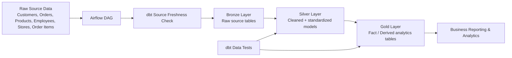

# Walmart Retail Data Engineering Pipeline

<div align="center">


</div>

A production-style retail data engineering project built to automate ingestion, validation, and transformation of Walmart-style sales data into analytics-ready Bronze, Silver, and Gold layers. The project demonstrates end-to-end pipeline orchestration with Apache Airflow and dbt, model-driven transformation patterns, and automated data quality checks for reliable business reporting.

## Why this project exists

Retail organizations often manage operational data across multiple systems such as customers, products, transactions, employees, and stores. When that data is fragmented and not standardized, reporting becomes inconsistent, delayed, and difficult to trust. This project addresses that challenge by creating a repeatable, automated data pipeline that turns raw transactional data into clean, analyst-friendly datasets for sales and operational analytics.

## Business problem solved

This project solves the problem of unreliable and manual retail analytics workflows by:

- Automating ingestion from multiple source tables
- Enforcing source freshness and operational checks
- Cleaning and standardizing raw datasets
- Building governed layered data models for business consumption
- Running data quality tests before data is used for reporting

## Architecture overview



## Tech stack

- Apache Airflow 3.x for orchestration and DAG management
- dbt Core for transformation logic and tests
- Databricks as the analytics warehouse target
- Python for data handling and operational support
- SQL for model design and transformations
- Docker Compose for local Airflow environment setup

## Pipeline flow

The workflow is orchestrated through a DAG that performs the following steps:

1. Trigger CDC-style ingestion
2. Clean target directories
3. Validate source freshness using dbt
4. Run Silver-layer technical transformations
5. Run Silver-layer business transformations
6. Execute dbt data quality tests on silver models
7. Build gold ephemeral models
8. Snapshot slowly changing dimensions
9. Materialize final gold fact tables

## Data model and layers

### Bronze layer
Raw source tables are loaded from the retail dataset for:
- customers
- orders
- products
- order_items
- stores
- employees

### Silver layer
Standardized and cleaned business/technical tables are created for reliable downstream consumption, including enriched model logic and data validation checks.

### Gold layer
The gold output includes analytical fact and dimension-style data used for business reporting, including product, customer, order, and employee insights.

## Project metrics

This project demonstrates a real-world retail analytics pipeline with measurable scope:

- 6 source tables
- 42,796 total records processed
- 13 dbt models
- 5 snapshots
- 10-task Airflow orchestration workflow
- 6 successful dbt validation checks
- 0 errors, 0 warnings, and 0 skipped checks in the successful run

## Repository structure

```text
Walmart_Airflow_DBT_Project-main/
├── README.md
├── Notes.png
├── airflow_dbt_project/
│   ├── Dockerfile
│   ├── docker-compose.yaml
│   ├── requirements.txt
│   ├── dags/
│   │   └── orchestrate.py
│   ├── config/
│   ├── logs/
│   └── walmart_project/
│       ├── dbt_project.yml
│       ├── profiles.yml
│       ├── models/
│       ├── macros/
│       ├── snapshots/
│       ├── tests/
│       └── README.md
├── walmart_dataset/
│   ├── data/
│   ├── ddl/
│   └── load_data.py
└── .gitignore
```

## Data quality and testing

The project includes dbt testing to validate critical keys and model integrity, such as:

- primary key completeness checks
- uniqueness validation
- null checks for key business identifiers
- consistency checks across the Silver and Gold layers

## How to run locally

### Prerequisites

- Docker Desktop
- Python 3.10+
- dbt Core installed
- Access to Databricks or an equivalent warehouse target

### Steps

1. Navigate to the Airflow project folder:

```bash
cd airflow_dbt_project
```

2. Build and start the Airflow environment:

```bash
docker-compose up --build
```

3. Validate the dbt project:

```bash
dbt parse --project-dir walmart_project --profiles-dir walmart_project
```

4. Run dbt transformations:

```bash
dbt run --project-dir walmart_project --profiles-dir walmart_project
```

5. Run tests:

```bash
dbt test --project-dir walmart_project --profiles-dir walmart_project
```

## Real-world value

This project simulates a real retail data engineering challenge: turning fragmented transactional data into trusted, reusable assets for business intelligence and analytics. It is especially relevant for teams building modern data platforms using Airflow and dbt for automation, lineage, and quality management.

## Resume-ready summary

Developed an end-to-end retail data engineering pipeline using Airflow, dbt, and Databricks to process 42,796 records across 6 business tables and automate data quality validation for analytics-ready reporting.

## Video

Watch the project walkthrough here:

https://youtu.be/ZEE-jNAthB0?si=ABQX_ApyBbGDD5SZ

## License

This project is provided for educational and portfolio use. You may adapt it to your own use case and learning workflow.


